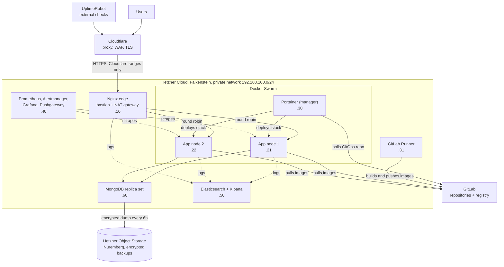
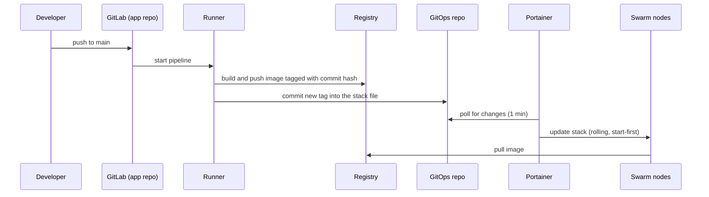

# ApplyOps Platform

**GitOps-driven Docker Swarm infrastructure on Hetzner Cloud, built entirely as code: Terraform, Ansible, GitLab CI/CD, a Cloudflare-protected edge, full-stack observability and encrypted off-site backups.**

<!-- Optional: add your role and organisation here ONLY if it is accurate and permitted. -->

## Overview

ApplyOps needed a hosting platform that is reproducible, secure by default and inexpensive to run. This repository contains everything needed to build and operate it: server provisioning, configuration management, the delivery pipeline, monitoring, logging and backup automation.

A commit to the application repository results in a new container image, a one-line change in a GitOps repository and a rolling update on the Swarm cluster, with no manual login to any server.

## Highlights

- **Infrastructure as code:** Terraform creates the servers, private network and firewalls; idempotent Ansible roles configure every node.
- **GitOps delivery:** GitLab CI builds images on a dedicated runner and tags them with the commit hash. The pipeline commits the new tag into a GitOps repository. Portainer polls that repository and applies the stack with rolling updates and automatic rollback.
- **Small attack surface:** one public entry point (the Nginx edge, which is also the SSH bastion and NAT gateway). Every other node is private-only. Ports 80/443 accept traffic from Cloudflare ranges only.
- **Observability:** Prometheus with node, container, HTTP and MongoDB exporters; Alertmanager email alerts; provisioned Grafana dashboards; Elasticsearch and Kibana with Filebeat for logs (14-day retention); UptimeRobot for external checks.
- **Data protection:** MongoDB runs as a replica set with role-based users. A dump is taken every 6 hours, encrypted with age and stored off-site in Hetzner Object Storage. Backup freshness is monitored and alerted.
- **Secrets hygiene:** Ansible Vault, Docker Swarm secrets, masked and protected CI variables. No secrets live in Git.

## Architecture



### Components

| Server | Private IP | Role | Key software |
|---|---|---|---|
| nginx | 192.168.100.10 | Public edge, SSH bastion, NAT gateway | Nginx, Let's Encrypt, Cloudflare Origin CA |
| app1, app2 | .21, .22 | Swarm workers running the application | Docker, cAdvisor |
| portainer | .30 | Swarm manager and GitOps controller | Portainer CE |
| runner | .31 | Dedicated CI runner | GitLab Runner (Docker executor) |
| monitoring | .40 | Metrics, alerting, dashboards | Prometheus, Alertmanager, Grafana, blackbox exporter, Pushgateway |
| elk | .50 | Centralised logging | Elasticsearch, Kibana (Filebeat on the shippers) |
| mongodb | .60 | Database and backup job | MongoDB, age, rclone, systemd timer |

### Delivery flow



Full details are in [docs/architecture.md](docs/architecture.md).

## Security model

- Only the edge server has a public IPv4 address; the other seven nodes sit on the private network and reach the internet through the edge NAT.
- Hetzner Cloud Firewalls with least-privilege rules per server role (see the firewall matrix in the architecture document).
- Ports 80/443 on the edge accept only Cloudflare IP ranges. All domains are proxied. TLS uses Cloudflare Origin CA for the application and Let's Encrypt (DNS-01) for the monitoring sites.
- Prometheus and Alertmanager sit behind HTTP basic auth at the edge; Grafana uses its own authentication.
- MongoDB uses a keyFile, authentication and separate users for the application, backup and monitoring, and is reachable only from the application nodes.
- Backups are encrypted with a public key (age), so a compromised database server cannot read old backups.

## Observability

- **Metrics:** node-exporter on every server, cAdvisor on application nodes, blackbox exporter for public endpoints and certificate expiry, MongoDB exporter.
- **Alerts:** instance down, CPU, memory and disk pressure, disk filling within 24 hours, container restarts, endpoint down or slow, certificate expiring, backup stale or failed. Delivered by email through Alertmanager.
- **Dashboards:** provisioned as code in Grafana (servers, containers, endpoints).
- **Logs:** container and Nginx logs shipped by Filebeat to Elasticsearch, with a 14-day lifecycle policy.
- **External checks:** UptimeRobot probes the public URLs from outside the network.

## Backup and recovery

- MongoDB: `mongodump` every 6 hours, encrypted with age, uploaded to Hetzner Object Storage, 14-day retention. Success and age of the latest backup are exported as metrics and alerted.
- Recovery procedures: [docs/runbooks](docs/runbooks). The recovery drill and its measured duration should be recorded in the MongoDB restore runbook.

## Status

| Area | Status |
|---|---|
| Terraform: servers, network, firewalls | Implemented |
| Ansible baseline, Docker, Swarm, Portainer | Implemented |
| Nginx edge, Cloudflare, TLS | Implemented |
| GitLab runner, CI/CD, GitOps flow | Implemented |
| Prometheus, Grafana, Alertmanager, exporters | Implemented |
| ELK with Filebeat | Implemented |
| MongoDB replica set and encrypted 6-hourly backups | Implemented |
| Scheduled server snapshots (every 6 hours) | Planned |
| Container image scanning in the pipeline | Planned |
| Application health endpoint and Swarm health checks | Planned |

## Roadmap: high availability

- Second location with its own Nginx and a standby application node.
- MongoDB secondary plus a small arbiter for automatic failover.
- Cloudflare Load Balancing with health checks for automatic traffic failover.
- Separate bastion and NAT from the edge server, TLS for MongoDB, SSO in front of the admin UIs.

## Getting started

**Prerequisites:** Terraform, Ansible (with the collections in `ansible/requirements.yml`), a Hetzner Cloud project and API token, a Cloudflare zone and API token, a GitLab group, Hetzner Object Storage credentials.

```bash
# 1. Provision
cd terraform
cp terraform.tfvars.example terraform.tfvars      # fill in real values (never commit this file)
terraform init && terraform apply

# 2. Configure
cd ../ansible
ansible-galaxy collection install -r requirements.yml
cp inventory.ini.example inventory.ini            # set the edge public IP and SSH key
cp group_vars/all/vault.yml.example group_vars/all/vault.yml
ansible-vault encrypt group_vars/all/vault.yml    # then edit it with real values

# 3. Apply, in this order
ansible-playbook site.yml                 # baseline, Docker, node exporters
ansible-playbook edge.yml                 # Nginx, certificates, NAT and bastion
ansible-playbook swarm.yml
ansible-playbook portainer.yml
ansible-playbook mongodb.yml
ansible-playbook runner.yml
ansible-playbook monitoring.yml
ansible-playbook monitoring_public.yml    # public HTTPS sites for the monitoring UIs
ansible-playbook elk.yml
ansible-playbook mongodb_backup.yml       # backup job, Pushgateway, alert rules
```

Then create the GitOps repository from `gitops-example/`, add `ci-examples/app.gitlab-ci.yml` to the application repository and create the Portainer stack from Git.

## Design decisions

See [docs/decisions](docs/decisions): Swarm over Kubernetes, polling-based GitOps, replica-set MongoDB from day one, encrypted off-site backups.

## Skills demonstrated

Terraform, Ansible, Docker Swarm, GitOps, GitLab CI/CD, Nginx, Cloudflare, Linux hardening, network and firewall design, Prometheus, Grafana, ELK, backup and recovery design, secrets management, runbook writing.

## License

MIT, see [LICENSE](LICENSE). All hostnames, domains and addresses in this repository are placeholders or private ranges.
